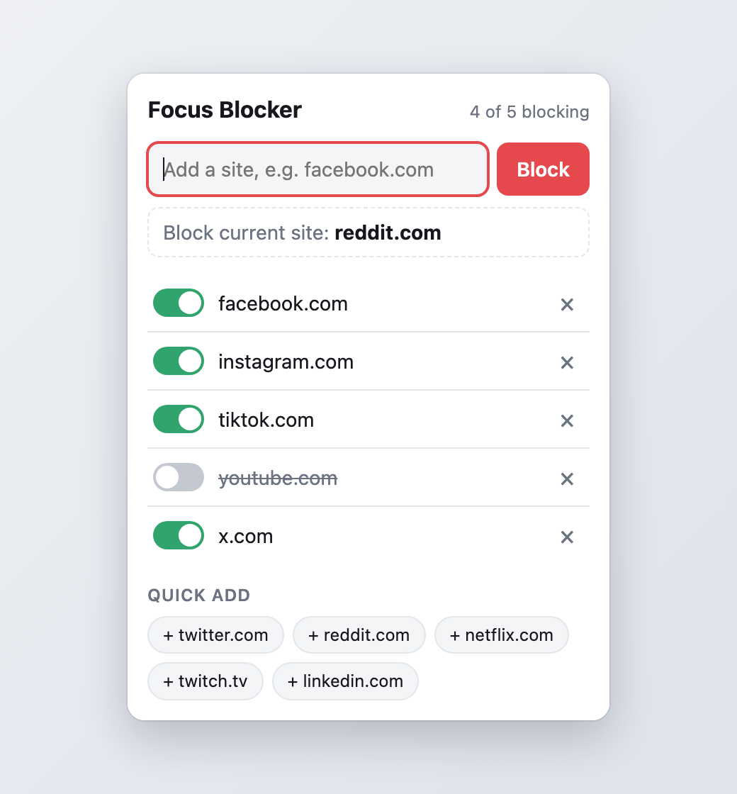
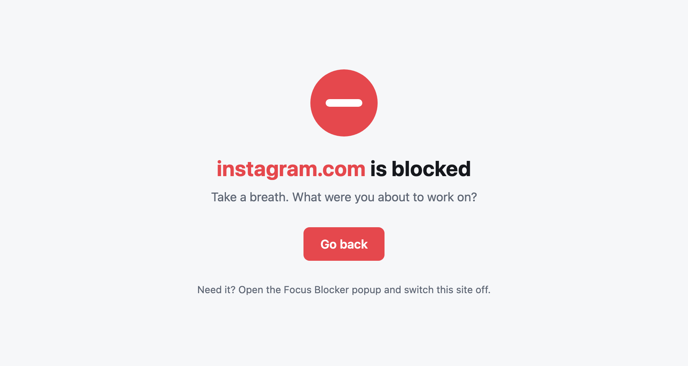

# Focus Blocker

[](https://github.com/Timothy1102/focus-blocker/actions/workflows/ci.yml)
[](LICENSE)


A small, private Chrome extension that blocks distracting websites like Facebook, Instagram and TikTok. Every site on your list has its own on/off switch, so you can allow one for a while without losing the rest of your list.

<p align="center">
  <picture>
    <source media="(prefers-color-scheme: dark)" srcset="docs/screenshots/popup-dark.png">
    
  </picture>
  &nbsp;&nbsp;
  <picture>
    <source media="(prefers-color-scheme: dark)" srcset="docs/screenshots/blocked-dark.png">
    
  </picture>
</p>

## Features

- **Per-site switches** – block, allow or remove each site independently.
- **Covers subdomains** – blocking `facebook.com` also blocks `www.facebook.com`, `m.facebook.com` and so on.
- **Forgiving input** – paste a full URL (`https://www.Facebook.com/feed`) or type a bare domain; both become `facebook.com`.
- **One-click shortcuts** – "Block current site" for the tab you are on, and quick-add chips for common time sinks.
- **Works on open tabs** – tabs already sitting on a newly blocked site are redirected immediately.
- **Private by design** – no accounts, no analytics, no network requests. The list never leaves your device. See [PRIVACY.md](PRIVACY.md).
- **Light and dark mode** – follows your system theme.

## Install

Focus Blocker is not on the Chrome Web Store yet, so load it as an unpacked extension:

1. Clone or [download](https://github.com/Timothy1102/focus-blocker/archive/refs/heads/main.zip) this repository.
2. Open `chrome://extensions`.
3. Turn on **Developer mode** (top right).
4. Click **Load unpacked** and select the project folder.
5. Pin the extension from the puzzle-piece menu so the popup is one click away.

To also block in Incognito, open the extension's **Details** page and enable **Allow in Incognito**.

Other Chromium-based browsers that support Manifest V3 (Edge, Brave, …) should work the same way but are untested.

## Usage

1. Click the toolbar icon.
2. Type a site (or paste a URL) and press **Block**, or use **Block current site** / a quick-add chip.
3. Flip a site's switch off to allow it again, or click **×** to remove it from the list.

Visiting a blocked site shows a short "blocked" page instead. Need the site after all? Open the popup and switch it off.

## How it works

| File | Role |
| --- | --- |
| [`manifest.json`](manifest.json) | Manifest V3 definition and permissions. |
| [`background.js`](background.js) | Service worker. Turns each enabled site into a [`declarativeNetRequest`](https://developer.chrome.com/docs/extensions/reference/api/declarativeNetRequest) redirect rule (subdomains included, top-level page loads only) and sends already-open tabs of newly blocked sites to the blocked page. |
| [`popup.html`](popup.html), [`popup.js`](popup.js), [`popup.css`](popup.css) | The popup: add, toggle and remove sites, plus the shortcuts. |
| [`blocked.html`](blocked.html), [`blocked.js`](blocked.js), [`blocked.css`](blocked.css) | The page you see instead of a blocked site. |
| [`shared.js`](shared.js) | Domain normalisation (`https://www.Facebook.com/feed` → `facebook.com`), host matching and storage helpers shared by the above. |

The block list lives in `chrome.storage.local`, on this device only. There are no dependencies and no build step.

## Permissions

| Permission | Why it is needed |
| --- | --- |
| `declarativeNetRequest` | Redirects blocked sites to the blocked page. Chrome evaluates the rules itself; the extension does not read page content. |
| `host_permissions: <all_urls>` | Chrome only allows redirect rules on sites the extension has host access to. Because you choose the sites, the extension cannot know the list ahead of time. No scripts are injected into pages. |
| `storage` | Saves your block list locally. |
| `tabs`, `activeTab` | Reads tab addresses to power "Block current site" and to redirect tabs that are already open on a newly blocked site. |

## Limitations

- Focus Blocker is a self-control aid, not a lock. Anyone with access to your browser can switch a site off, disable the extension, or use another browser or profile.
- Only top-level page loads are redirected. Embedded content (for example a Facebook "Like" button on another site) is not blocked.

## Development

There are no dependencies to install. The tests use Node's built-in runner (Node 20+):

```bash
npm test
```

To try your changes, open `chrome://extensions`, load the folder unpacked, and click the reload icon on the extension card after editing. The service worker's console is available from the card's **service worker** link.

To build a zip for distribution:

```bash
npm run package   # writes dist/focus-blocker.zip
```

## Contributing

Bug reports, ideas and pull requests are welcome. See [CONTRIBUTING.md](CONTRIBUTING.md) for the short version.

## License

[MIT](LICENSE) © Tim Vu
